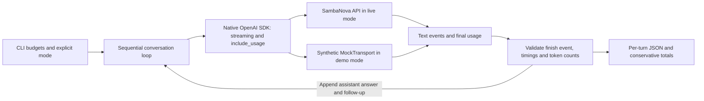

# SambaNova Inference Benchmark

Stream a chat completion through the native OpenAI Python SDK against SambaNova's compatible endpoint, read the provider's extended timing usage, and repeat the call in a bounded conversation loop. Each next turn includes the previous answer, making context growth visible in the reported prompt-token count.

The program reports `time_to_first_token` and `completion_tokens_after_first_per_sec` exactly as the provider supplies them. It measures client wall time separately. It never counts text chunks as tokens, treats characters as tokens, or estimates server decode duration from a throughput rate. Missing or invalid timing fields fail the measurement instead of producing plausible numbers.

## Run

Requires Python 3.11+. The verified SDK is `openai==3.55.1`, which uses `httpx2`.

```powershell
python -m venv .venv
.\.venv\Scripts\python.exe -m pip install -r requirements.txt
.\.venv\Scripts\python.exe -B -m samba_bench --demo --steps 10
.\.venv\Scripts\python.exe -B -m unittest discover -s tests -v
```

The default and `--demo` modes use invented SSE events through the actual SDK's mock HTTP transport. They open no network connections, require no key, and mark `performance_evidence: false`. The fixture's 0.25-second timing and 80-token/s rate are invented test inputs, not observations about hardware or a provider.

For a real measurement, set your own key in the terminal and explicitly select live mode:

```powershell
$env:SAMBANOVA_API_KEY = "your-key-here"
.\.venv\Scripts\python.exe -B -m samba_bench --live --steps 1
.\.venv\Scripts\python.exe -B -m samba_bench --live --steps 10 --max-tokens 300
```

Live mode sends billed requests to `https://api.sambanova.ai/v1`, with model `GLM-5.3` by default. `--model` selects another model your account supports. Set `--prompt` to compare the same task across runs. Maximums are ten turns, 4,096 output tokens per turn, 4,000 prompt characters, and 20,000 active conversation characters. A 30-second deadline is checked between stream events, alongside the SDK's 20-second per-operation network timeout. Output limits are reported using `finish_reason: length`; they are not confused with a complete answer. API retries are disabled so one configured turn does not silently become several billable attempts.

## Architecture



## CODE MAP

| File | Responsibility and connections |
|---|---|
| `samba_bench/__init__.py` | Package identity. |
| `samba_bench/client.py` | Native SDK streaming call, output budgets, required timing validation, token-count checks, and bounded context loop. |
| `samba_bench/fixtures.py` | Invented SSE envelopes and native SDK `MockTransport` client; used by the default demo and tests. |
| `samba_bench/__main__.py` | CLI options, explicit live credential gate, native client lifetime, sanitized failures, and JSON output. |
| `tests/test_measurements.py` | Native SDK parsing, no-socket assertion, request/context sequence, timing errors, truncation and budget cases, and CLI tests. |
| `requirements.txt` | Pins the tested native SDK and transport. |
| `.gitignore` | Excludes environments, caches, generated data and local secrets. |

## Interpret the result

The loop represents sequential model turns; it has no autonomous agent or external tools. Summed time to first token is labeled with the provider field name: it is not asserted to isolate prefill compute. Completion-token totals come only from returned usage. A decode-duration total stays `null`, because the demonstrated timing fields do not establish the provider's complete server-time accounting. A client measurement and a server metric cover different intervals.

A live result describes that endpoint, model, prompt, account and run. It does not establish equivalence to a single GPU's bandwidth ceiling, reproduce a chip benchmark, show a speedup over GPUs, or validate model quality. No live provider request or hardware benchmark is part of the offline verification. Model availability and extended usage fields can change; a missing field produces a controlled error. The original workload behind any external multi-step timing result is not available here.

References: [SambaNova dataflow architecture](https://sambanova.ai/products/dataflow-architecture), [official OpenAI Python SDK](https://github.com/openai/openai-python).
